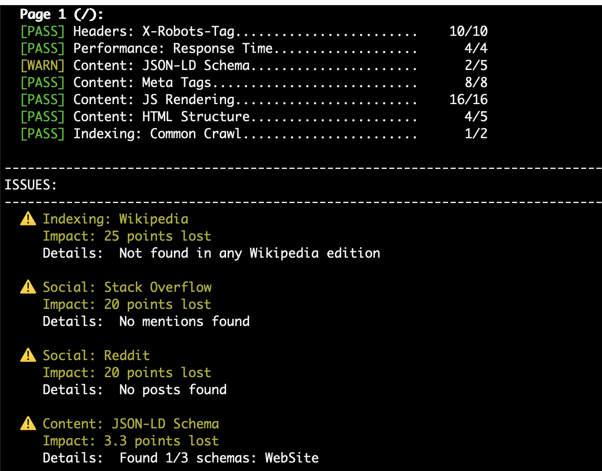
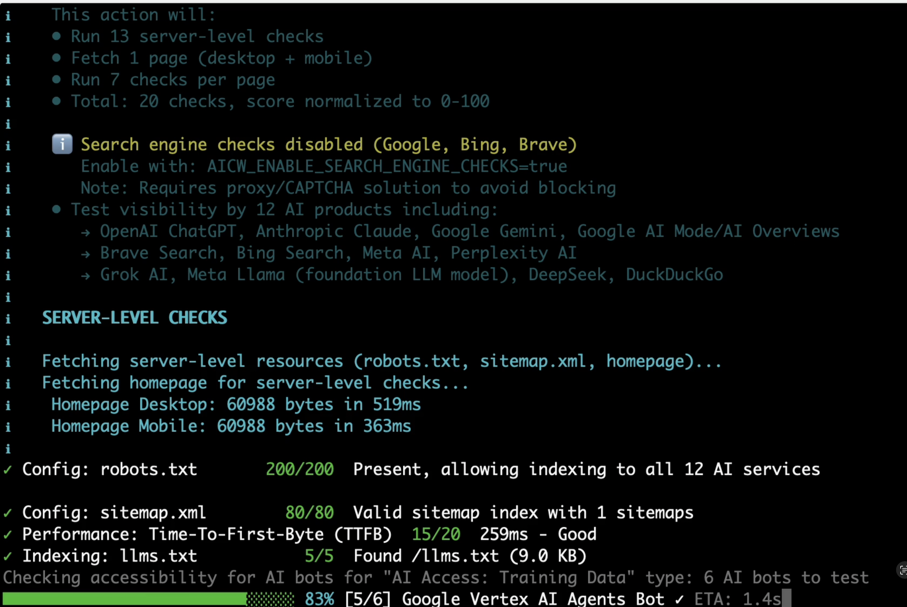
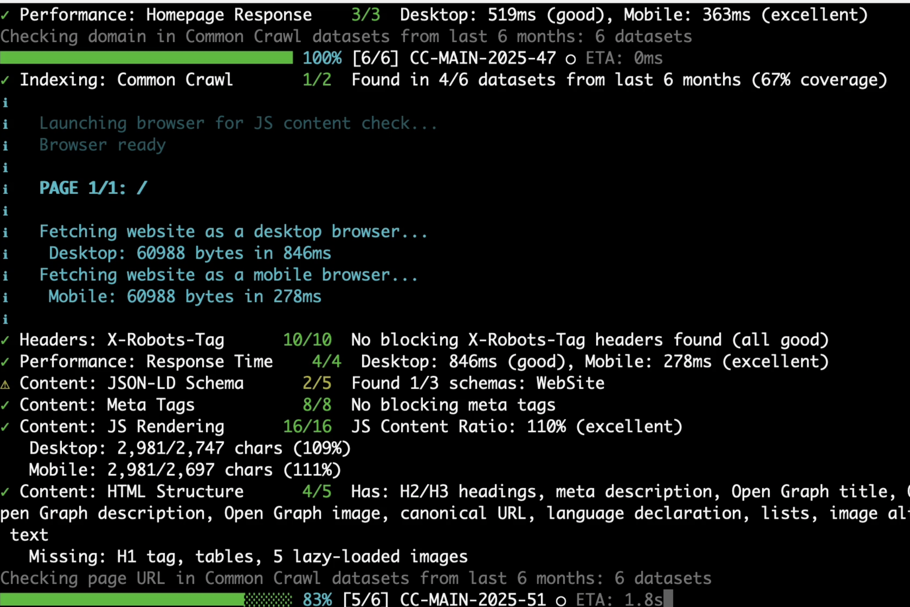
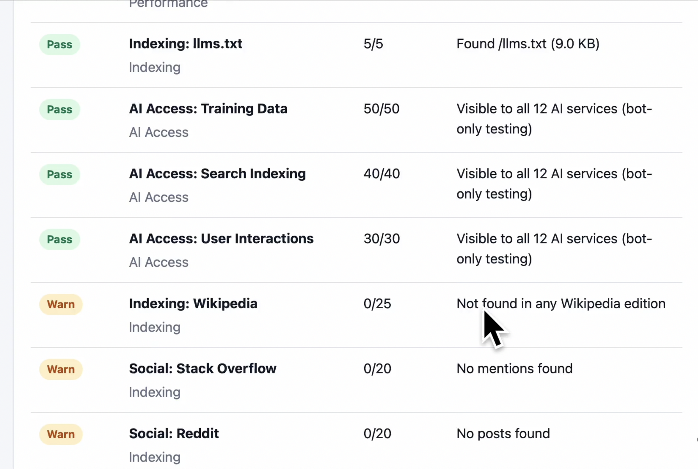

# AICW Visibility

Open-source and free website AI visibility checker for AI crawlers, answer engines, and public datasets. Your data is not shared anywhere, everything runs from your machine.

## Screenshots









## Video Demo

https://github.com/user-attachments/assets/8b5c2a43-4508-4fcb-9106-c6305c1200f7

## Install

```bash
npx aicw-visibility YOUR_WEBSITE_URL
```

Or install globally:

```bash
npm install -g aicw-visibility
aicw-visibility YOUR_WEBSITE_URL
```

## Features

- Checks `robots.txt`, sitemap, `llms.txt`, headers, meta tags, JSON-LD, and HTML structure.
- Tests visibility to AI bots across training, search indexing, and user interaction crawlers.
- Checks URL/domain presence in Common Crawl and selected public web sources.
- Uses Puppeteer by default for JavaScript-rendered content comparison.
- Writes a local HTML report plus timestamped JSON data.

If Puppeteer's browser is missing locally:

```bash
npx puppeteer browsers install chrome
```

To skip browser rendering checks:

```bash
aicw-visibility example.com --no-browser
```

## MCP

AICW Visibility also includes a stdio MCP server for AI agents:

```bash
npx --yes --package aicw-visibility aicw-visibility-mcp
```

Example MCP config:

```json
{
  "mcpServers": {
    "aicw-visibility": {
      "command": "npx",
      "args": ["--yes", "--package", "aicw-visibility", "aicw-visibility-mcp"]
    }
  }
}
```

It exposes `check_visibility`, which runs the same checker and returns the terminal output plus the generated report path.

## License

MIT. See [LICENSE](LICENSE).
